# Orders API — Servicio REST serverless con Lambda y API Gateway

Este repositorio contiene una API REST para administrar órdenes mediante Java 17 y Maven, desplegada con AWS Lambda y Amazon API Gateway.

## Autoría
- Juan Lozano

## Compilación y pruebas

Se requiere Java 17 y Maven 3.9 o posterior. Las pruebas unitarias se ejecutan sin conectarse a AWS.

```bash
mvn test       # ejecuta las pruebas unitarias (no requiere AWS)
mvn package    # genera target/orders-api-1.0.0.jar
```

---

## 1. Contrato y diseño de la API

### Estructura de una orden

```json
{
  "id": "ORD-001",
  "customerId": "CUST-42",
  "product": "MacBook Air",
  "quantity": 1
}
```

### Respuesta común de error

```json
{
  "error": "ORDER_NOT_FOUND",
  "message": "Order ORD-999 does not exist"
}
```

| Valor de `error`   | HTTP | Situación                                                        |
|--------------------|------|--------------------------------------------------------------|
| `INVALID_REQUEST`  | 400  | Cuerpo inválido, campo faltante, `quantity < 1`, parámetro faltante |
| `ORDER_NOT_FOUND`  | 404  | La orden solicitada no existe                                |
| `INTERNAL_ERROR`   | 500  | Error inesperado (no se exponen detalles internos)           |

### Endpoints disponibles

#### Crear una orden — `POST /orders`

- **Parámetros de ruta:** ninguno · **Parámetros de consulta:** ninguno
- **Cuerpo de la petición:**
  ```json
  { "customerId": "CUST-42", "product": "MacBook Air", "quantity": 1 }
  ```
- **Respuesta exitosa:** `201 Created`, encabezado `Location: /orders/ORD-004` y la orden creada, con el `id` generado.
- **Errores posibles:** `400 INVALID_REQUEST` ante JSON inválido, `customerId` o `product` vacíos, `quantity` ausente o menor que 1; `500 INTERNAL_ERROR` ante una falla inesperada.

#### Consultar una orden — `GET /orders/{id}`

- **Parámetro de ruta:** `id` (por ejemplo, `ORD-001`) · **Consulta:** ninguna · **Cuerpo:** ninguno
- **Respuesta exitosa:** `200 OK` con la orden.
- **Errores posibles:** `404 ORDER_NOT_FOUND` o `500 INTERNAL_ERROR`.

#### Buscar órdenes de un cliente — `GET /orders?customerId={customerId}`

- **Parámetro de ruta:** ninguno · **Consulta obligatoria:** `customerId` · **Cuerpo:** ninguno
- **Respuesta exitosa:** `200 OK` con un arreglo JSON. Si el cliente no tiene órdenes, se responde `200 OK` con `[]`.
- **Errores posibles:** `400 INVALID_REQUEST` si falta `customerId`; `500 INTERNAL_ERROR` ante una falla inesperada.

> `DELETE /orders/{id}` se agrega en el reto final (sección 17).

### Decisiones sobre recursos y respuestas

**¿Cuáles son los recursos del API?**
La API expone la **colección de órdenes** (`/orders`) y cada elemento (`/orders/{id}`). En esta versión, los clientes no son recursos independientes; su identificador se usa únicamente para filtrar.

**¿Por qué `/orders/{id}` para obtener una orden?**
El `id` distingue una orden de todas las demás. Como cada orden pertenece a `/orders`, su dirección estable se expresa como una ruta (`/orders/{id}`) en vez de un parámetro opcional.

**¿Por qué `customerId` es un query parameter en la búsqueda?**
`customerId` no representa un recurso: **filtra** `/orders`, cuyo resultado sigue siendo una colección, aunque esté vacía. Los parámetros de consulta permiten combinar filtros más adelante (por ejemplo, `?customerId=...&product=...`). `/customers/{id}/orders` sería una alternativa válida si el sistema administrara clientes como recursos, pero no es el caso.

**¿Qué debe retornar `POST /orders` al crear una orden?**
La respuesta adecuada es `201 Created`, con la orden resultante y el identificador asignado por el servidor. El encabezado `Location` debe apuntar al nuevo recurso (`/orders/ORD-004`).

**¿Qué debe retornar el API si una orden no existe?**
Debe responderse `404 Not Found` con `{"error": "ORDER_NOT_FOUND", "message": "Order ORD-999 does not exist"}`. Si la búsqueda de un cliente no encuentra órdenes, no corresponde un 404: existe la colección y el resultado es `200 []`.

**¿Qué información debe contener una respuesta de error?**
La respuesta debe incluir un código `error` estable para que los clientes puedan tomar decisiones y un `message` comprensible para las personas. No debe revelar trazas ni datos internos: el estado HTTP comunica la categoría general y `error` identifica la causa concreta.

---

## 2. Parte I — Núcleo Java independiente

### Organización del proyecto

```
src/main/java/edu/eci/orders/
├── domain/                 # Conceptos del negocio (Java puro)
│   ├── Order.java
│   ├── CreateOrderRequest.java
│   ├── OrderNotFoundException.java
│   └── ValidationException.java
├── application/            # Lógica de la aplicación (Java puro)
│   ├── OrderService.java       # registerOrder, retrieveOrder, listOrdersForCustomer
│   └── OrderRepository.java    # interfaz de almacenamiento
└── infrastructure/
    └── InMemoryOrderRepository.java   # almacenamiento en memoria (no persistente)
```

- `OrderService` comprueba la entrada y usa **excepciones de dominio** (`ValidationException`, `OrderNotFoundException`) para señalar problemas. No conoce estados HTTP: el componente de transporte (API Gateway o el adaptador) se encarga de mapearlas a 400/404.
- `InMemoryOrderRepository.createPreloadedRepository()` inicia con `ORD-001` y `ORD-002` asociados a `CUST-42`, y `ORD-003` a `CUST-7`; así es posible consultar órdenes desde el primer arranque de Lambda. **El contenido en memoria no es duradero**: desaparece al renovar el entorno y cada función dispone de su propia copia.

### Punto de control 1

Las respuestas siguientes corresponden al cierre de la Parte I, antes de añadir los handlers de Lambda.

**¿Se puede validar sin AWS?** Sí. `mvn test` ejecuta 21 pruebas JUnit para `OrderService`, sin conexión de red ni servicios de AWS.

**¿Hace falta un servidor web?** No. Se trata de una biblioteca Java que se utiliza mediante llamadas a sus métodos.

**¿Depende de Spring Boot?** No. Solo se usa JUnit para las pruebas, bajo el scope `test`.

**¿Qué se incluye en el JAR de esta fase?** Las clases compiladas de `domain`, `application` e `infrastructure`, más los metadatos de Maven (`META-INF/MANIFEST.MF`, `pom.xml` y `pom.properties`). Todavía no contiene bibliotecas externas ni handlers de Lambda.

**¿Qué componentes conocen HTTP en este punto?** Ninguno. El código aún no maneja requests, responses, headers ni estados HTTP.

---

## 3. Parte II — Handlers Java desplegados en Lambda

La aplicación central no se rediseñó para Lambda. Se añadió el paquete `edu.eci.orders.lambda.custom`, con un handler ligero para cada operación. Cada uno recibe el objeto de entrada, delega el trabajo en `OrderService` y devuelve el valor obtenido:

| Lambda              | Handler                                                               | Entrada (JSON)                                   | Salida (JSON)    |
|---------------------|-----------------------------------------------------------------------|--------------------------------------------------|------------------|
| `orders-create`     | `edu.eci.orders.lambda.custom.CreateOrderHandler::handleRequest`      | `{"customerId":"CUST-42","product":"MacBook Air","quantity":1}` | orden creada     |
| `orders-get`        | `edu.eci.orders.lambda.custom.GetOrderHandler::handleRequest`         | `{"id":"ORD-001"}`                               | orden            |
| `orders-find`       | `edu.eci.orders.lambda.custom.FindOrdersByCustomerHandler::handleRequest` | `{"customerId":"CUST-42"}`                   | arreglo de órdenes |

Todos los handlers implementan `RequestHandler<Entrada, Salida>` de `aws-lambda-java-core`, la única dependencia de AWS agregada hasta aquí. El plugin `maven-shade-plugin` empaqueta esa biblioteca dentro del JAR.

**Configuración en AWS Academy Learner Lab:** runtime Java 17, arquitectura *x86_64*, rol disponible `LabRole` (el entorno no permite crear roles), memoria de 512 MB, timeout de 15 segundos y archivo `target/orders-api-1.0.0.jar`.

**Evidencia: creación y configuración de `orders-create`**

*Entorno AWS Academy Learner Lab iniciado*

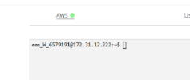

*Función creada (Java 17, LabRole)*

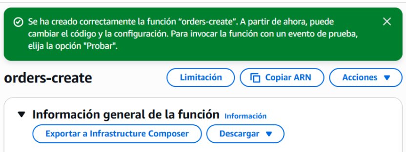

*Carga del JAR orders-api-1.0.0.jar*

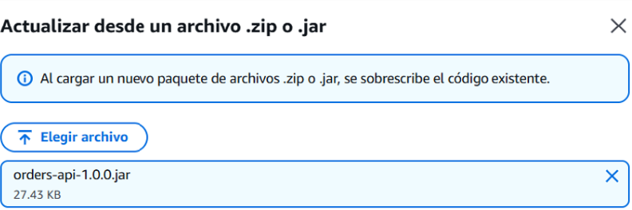

*Configuración del handler*

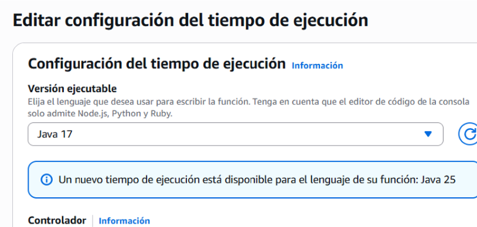

*Memoria 512 MB y timeout 15 s*

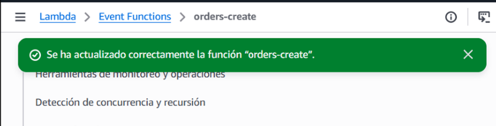

**Manejo de errores:** las excepciones de dominio se convierten en `OrderApiException`, cuyo mensaje contiene el objeto JSON de error (`{"error":"ORDER_NOT_FOUND","message":"..."}`). Los handlers **no** asignan códigos HTTP; en la Arquitectura A esa tarea corresponde a API Gateway (Parte IV).

### Diagrama de la solución (punto de control 2)

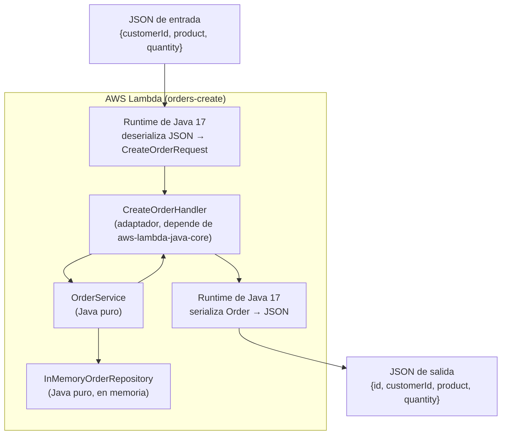

### Conversión de JSON a objetos Java y viceversa

1. El **handler** (`paquete.Clase::metodo`) especifica qué clase crear y qué método ejecutar. Lambda crea la instancia con el constructor sin argumentos una vez por entorno, y la reutiliza en invocaciones *warm*. Por eso el `OrderService` estático conserva su estado mientras el entorno continúe disponible.
2. El runtime inspecciona por reflexión los tipos genéricos de `RequestHandler<CreateOrderRequest, Order>` para determinar la clase destino de la entrada.
3. El evento JSON se deserializa con el mecanismo interno basado en Jackson y las convenciones JavaBeans: se construye el POJO vacío y se cargan sus propiedades mediante *setters*. Por esta razón `CreateOrderRequest` y `Order` exponen constructor vacío, getters y setters.
4. El resultado se serializa a JSON usando los *getters*. Cuando el resultado es una `List<Order>`, la salida es un arreglo JSON.
5. Si el método arroja una excepción, Lambda genera un objeto JSON con `errorMessage`, `errorType` y `stackTrace`; `errorMessage` corresponde al mensaje de la excepción.
6. Para gestionar manualmente ambos flujos se puede implementar `RequestStreamHandler`, que recibe `InputStream` y `OutputStream` y evita la conversión automática.

### Pruebas sobre la función desplegada (`orders-create`)

| # | Entrada | Resultado | Qué demuestra |
|---|---------|-----------|---------------|
| 1 | `{"customerId":"CUST-42","product":"MacBook Air","quantity":1}` | `{"id":"ORD-004","customerId":"CUST-42","product":"MacBook Air","quantity":1}` | El JSON se convierte en `CreateOrderRequest` y el `Order` retornado vuelve a JSON. Es `ORD-004` porque los datos de ejemplo ocupan `ORD-001`…`ORD-003`. Duración 61.83 ms, facturada 442 ms (arranque en frío: carga de la JVM y de las clases). |
| 2 | `{"customerId":"CUST-100","product":"Monitor","quantity":3}` | `{"id":"ORD-005",...}` | El entorno se reutilizó (invocación *warm*): el contador en memoria continuó en 5. |
| 3 | `{"customerId":"CUST-42","product":"Mouse","quantity":0}` | Error: `errorMessage` = `{"error":"INVALID_REQUEST","message":"quantity must be greater than 0"}`, `errorType` = `edu.eci.orders.lambda.custom.OrderApiException`, más `stackTrace` | Una excepción del handler se convierte en el JSON de error del runtime; `errorMessage` es el mensaje de la excepción. |
| 4 | `{"customerId":"CUST-42","product":"Mouse","quantity":1,"color":"red"}` | `{"id":"ORD-006",...}` | Las propiedades desconocidas se **ignoran**; no hacen fallar la deserialización. Duración 1.86 ms (warm). |
| 5 | `{"customerId":"CUST-42","product":"Mouse","quantity":"abc"}` | Error: `errorMessage` = `"An error occurred during JSON parsing"`, `errorType` = `java.lang.RuntimeException`, `stackTrace` = `[]` | La conversión ocurre **antes** de llamar al handler: con un tipo incompatible, el runtime falla al parsear y el código Java nunca se ejecuta (la traza está vacía y no aparece `CreateOrderHandler`). |

**Evidencia: invocaciones manuales de `orders-create`**

*1. CUST-42 → ORD-004*

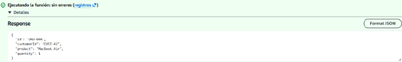

*2. CUST-100 → ORD-005 (entorno reutilizado)*

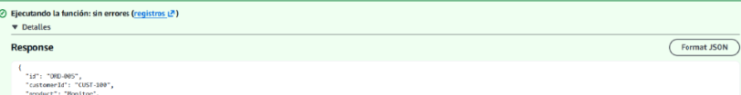

*3. quantity = 0 → INVALID_REQUEST*

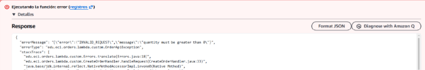

*4. Propiedad desconocida "color" → ignorada*

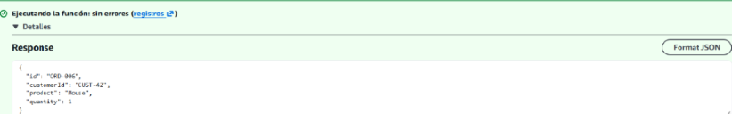

*5. quantity = "abc" → error de parsing del runtime*

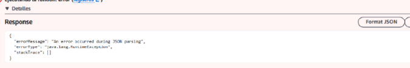

### Conclusiones de las invocaciones

El runtime Java de Lambda conecta JSON con métodos Java: toma el tipo genérico del handler, aplica las reglas JavaBeans (e ignora propiedades desconocidas), ejecuta la lógica y convierte el resultado en JSON mediante sus getters. Las pruebas muestran dos clases de error:

- **Errores de conversión del runtime:** ocurren antes de invocar el código y devuelven un mensaje genérico (`An error occurred during JSON parsing`).
- **Excepciones de la aplicación:** Lambda las serializa en los campos `errorMessage`, `errorType` y `stackTrace`.

La salida original de Lambda no debe reenviarse directamente a un cliente HTTP porque `stackTrace` puede revelar detalles internos. En la Parte IV se asigna a API Gateway la tarea de filtrar esa información.

La secuencia ORD-004, ORD-005 y ORD-006 confirma que el estado en memoria continúa entre invocaciones *warm*. No es almacenamiento persistente: se pierde al reciclar Lambda y no se replica entre distintas funciones.

### Nota sobre la carga del handler

La primera invocación de `orders-get` falló con `ClassNotFoundException: edu.eci.orders.lambda.custom.GetOrderHandler`. El SHA-256 inicial (`o0czLMg+...`) era del ejemplo predeterminado porque el JAR no se había cargado. Luego de subirlo, el hash pasó a `ssSHPxDoN7Qk...`, el mismo de `orders-create`, y la función respondió correctamente.

Esto indica que Lambda **no comprueba el handler al guardar los ajustes**. La clase se busca por reflexión en la primera invocación (inicio en frío); los errores en el nombre o en el empaquetado se descubren al ejecutar la función.

**Evidencia: creación de `orders-get` y `ClassNotFoundException`**

*Función orders-get creada*

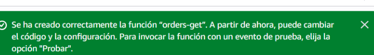

*Handler GetOrderHandler configurado*


*ClassNotFoundException (JAR no cargado, SHA-256 del código por defecto)*

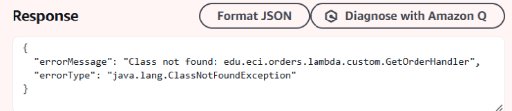

| Lambda | Entrada | Resultado |
|---|---|---|
| `orders-get` | `{"id":"ORD-001"}` | `{"id":"ORD-001","customerId":"CUST-42","product":"MacBook Air","quantity":1}` |
| `orders-get` | `{"id":"ORD-999"}` | Error: `errorMessage` = `{"error":"ORDER_NOT_FOUND","message":"Order ORD-999 does not exist"}` |
| `orders-find` | `{"customerId":"CUST-42"}` | `[{"id":"ORD-001",...,"product":"MacBook Air"},{"id":"ORD-002",...,"product":"Magic Mouse"}]` |
| `orders-find` | `{"customerId":"CUST-100"}` | `[]` |
| `orders-find` | `{"customerId":""}` | Error: `errorMessage` = `{"error":"INVALID_REQUEST","message":"customerId is required"}` |

**Evidencia: invocaciones de `orders-get` y `orders-find`**

*orders-get: ORD-001*

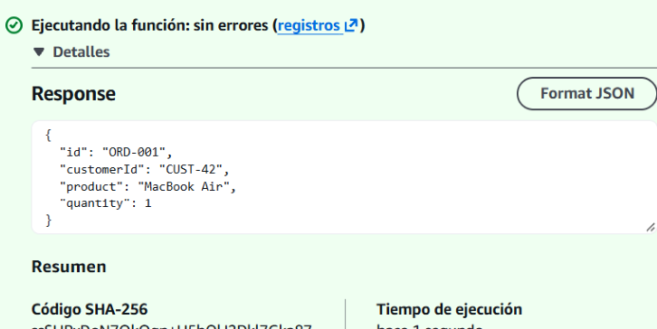

*orders-get: ORD-999 → ORDER_NOT_FOUND*

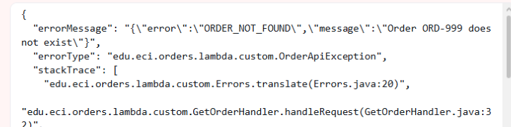

*orders-find: CUST-42 → 2 órdenes*

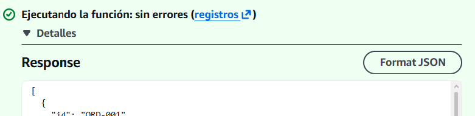

*orders-find: CUST-100 → []*

![orders-find: CUST-100 → []](docs/evidence/part2/16-orders-find-cust100.png)

*orders-find: customerId vacío → INVALID_REQUEST*

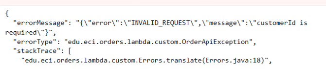

`orders-find` devuelve `[]` para `CUST-100` aunque `orders-create` ya había creado `ORD-005` para ese cliente. Cada función Lambda tiene su propio entorno de ejecución y, por lo tanto, su propia copia del repositorio en memoria. Con una Lambda por operación, el estado no se comparte entre operaciones.

---

## 4. Partes III y IV — Integración Lambda no proxy en API Gateway (Arquitectura A)

La API REST Regional `orders-api-mapping` utiliza Lambda **sin proxy**. API Gateway convierte cada solicitud HTTP en el JSON esperado por el handler y, a su vez, adapta la respuesta de Lambda al formato HTTP.

Las plantillas de mapeo usadas están en [apigateway/architecture-a/](apigateway/architecture-a/).

**Rutas y métodos configurados en `orders-api-mapping`:**

```
/
└── /orders
    ├── GET     → orders-find    (?customerId=...)
    ├── POST    → orders-create
    └── /{id}
        └── GET → orders-get
```


### `GET /orders/{id}` → `orders-get`

**Solicitud de integración**, plantilla `application/json` ([get-order.request.vtl](apigateway/architecture-a/get-order.request.vtl)):

```
{
  "id": "$util.escapeJavaScript($input.params('id'))"
}
```

La expresión `$input.params('id')` obtiene el valor de `{id}` y API Gateway arma `{"id":"ORD-001"}`. El handler solo recibe ese identificador, no la solicitud HTTP original.

**Evidencia: método GET de `/orders/{id}` con proxy deshabilitado**

*Método GET creado en `/orders` y su recurso `/{id}`*


*Vista de Solicitud de método; las plantillas se definen en Solicitud de integración*


**Comportamiento inicial: las fallas también devuelven 200.** Este resultado se obtiene al configurar solamente la plantilla de solicitud:

| Petición | Estado | Cuerpo |
|---|---|---|
| `GET /orders/ORD-001` | 200 | `{"id":"ORD-001","customerId":"CUST-42","product":"MacBook Air","quantity":1}` |
| `GET /orders/ORD-999` | **200** | `{"errorMessage":"{\"error\":\"ORDER_NOT_FOUND\",...}","errorType":"...OrderApiException","stackTrace":[...]}` |

**Evidencia: prueba de `GET /orders/{id}` antes de mapear errores**

*ORD-001 → 200*


*ORD-999 → 200 con la respuesta cruda de Lambda (stackTrace incluido)*


Con integración no proxy, API Gateway usa 200 como *respuesta predeterminada* salvo que una expresión regular reconozca el `errorMessage`. Si no se transforma también el contenido, el cliente puede recibir `stackTrace` y otros datos internos. Por ello, cada ruta debe tener configurado su mapeo de errores HTTP.

**Configuración del error para `GET /orders/{id}`:**

1. En *Respuesta de método* se añade el estado `404` con modelo `Empty` y contenido `application/json`.
2. En *Respuesta de integración*, `.*"error":"ORDER_NOT_FOUND".*` detecta el código dentro de `errorMessage` y selecciona el estado `404`. La plantilla [error.response.vtl](apigateway/architecture-a/error.response.vtl) entrega el JSON de error propio y elimina `errorType` y `stackTrace`.

La expresión por sí misma ya fijaba el estado 404, aunque el cuerpo aún contenía la salida original de Lambda. API Gateway define por separado el **estado HTTP** y el **cuerpo** de respuesta.

| Petición | Estado | Cuerpo |
|---|---|---|
| `GET /orders/ORD-999` | 404 | `{"error":"ORDER_NOT_FOUND","message":"Order ORD-999 does not exist"}` |

**Evidencia: configuración y prueba del 404**

*Respuesta de integración: regex ORDER_NOT_FOUND → 404*


*Regex configurada, sin plantilla: 404 pero con cuerpo crudo*


*Regex + plantilla: 404 con el error en el formato del API*


**Despliegue:** la etapa `dev` quedó publicada en `https://ggo6458fw1.execute-api.us-east-1.amazonaws.com/dev`.

```
$ curl -i https://ggo6458fw1.execute-api.us-east-1.amazonaws.com/dev/orders/ORD-001
HTTP/1.1 200 OK
Content-Type: application/json

{"id":"ORD-001","customerId":"CUST-42","product":"MacBook Air","quantity":1}

$ curl -i https://ggo6458fw1.execute-api.us-east-1.amazonaws.com/dev/orders/ORD-999
HTTP/1.1 404 Not Found
Content-Type: application/json

{"error":"ORDER_NOT_FOUND","message":"Order ORD-999 does not exist"}
```

**Evidencia de publicación en `dev`**

*Etapa de desarrollo y dirección pública de invocación*


La petición `GET /orders/ORD-004` también responde 404, pese a que `orders-create` creó ese identificador en la Parte II. El dato estaba en la memoria de otra función Lambda.

### `GET /orders?customerId={customerId}` → `orders-find`

- *Solicitud de método*: se registra `customerId` como parámetro de consulta, pero no se marca obligatorio. `OrderService` valida su presencia y genera el mismo formato de error que para las demás operaciones.
- *Solicitud de integración*, con tipo `application/json` ([find-orders.request.vtl](apigateway/architecture-a/find-orders.request.vtl)):
  ```
  {
    "customerId": "$util.escapeJavaScript($input.params('customerId'))"
  }
  ```
  `$input.params('customerId')` consulta la ruta, la query string y los encabezados. Cuando no encuentra el parámetro, devuelve una cadena vacía que `OrderService` rechaza.
- *Respuesta de método*: `400`.
- *Respuesta de integración*: regex `.*"error":"INVALID_REQUEST".*` → `400`, con la plantilla [error.response.vtl](apigateway/architecture-a/error.response.vtl).

La consola solo permite asociar una *Respuesta de integración* con un estado previamente registrado en *Respuesta de método* (de lo contrario aparece "No hay códigos de estado de respuesta de método disponibles"). Primero se autorizan los estados posibles; luego se especifican las condiciones para producirlos.

La pestaña *Prueba* de API Gateway produjo los siguientes resultados:

| Petición | Estado | Cuerpo |
|---|---|---|
| `GET /orders?customerId=CUST-42` | 200 | `[{"id":"ORD-001",...,"product":"MacBook Air",...},{"id":"ORD-002",...,"product":"Magic Mouse",...}]` |
| `GET /orders?customerId=CUST-100` | 200 | `[]` |
| `GET /orders` (sin `customerId`) | 400 | `{"error":"INVALID_REQUEST","message":"customerId is required"}` |

**Evidencia de la consulta `GET /orders?customerId=`**

*Sin códigos declarados en Respuesta de método no se puede crear la Respuesta de integración*


*customerId=CUST-42 → 200*


*customerId=CUST-100 → 200 []*

![customerId=CUST-100 → 200 []](docs/evidence/part4/09-find-cust100-200-empty.png)

*Sin customerId → 400 INVALID_REQUEST*


*Sin customerId → 400 (prueba repetida)*


**Cambios aún no publicados:** antes de desplegar de nuevo la etapa, la URL pública respondía `403 {"message":"Missing Authentication Token"}` para `GET /orders?customerId=CUST-42`. API Gateway muestra ese resultado cuando la ruta o el método todavía no existe en la versión publicada. Los cambios de consola entran en vigor al implementar la API en una etapa.

### `POST /orders` → `orders-create`

- *Solicitud de integración*, plantilla `application/json` ([create-order.request.vtl](apigateway/architecture-a/create-order.request.vtl)): `$input.json('$')` reenvía intacto el cuerpo, que ya corresponde a `CreateOrderRequest`.
- *Respuesta de método*: se registraron `201` y `400`.
- *Respuesta de integración*:

| Regex sobre `errorMessage` | Estado | Plantilla |
|---|---|---|
| *(vacía, respuesta predeterminada)* | **201** | ninguna: se devuelve la orden creada |
| `(.*"error":"INVALID_REQUEST".*)\|(An error occurred during JSON parsing.*)` | **400** | [error.response.vtl](apigateway/architecture-a/error.response.vtl) |

La segunda opción de la expresión contempla el error del **runtime de Lambda** cuando no puede convertir el JSON a `CreateOrderRequest`. Como ese `errorMessage` no contiene el JSON de la aplicación, la rama `#else` de la plantilla produce una respuesta con el contrato de la API.

**Observaciones de la configuración:**
- El estado de una respuesta de integración existente **no admite edición**, pues forma parte de su identificador. Para obtener 201 en caso exitoso se eliminó la respuesta predeterminada 200 y se creó una nueva con expresión vacía y estado 201.
- API Gateway permite una sola respuesta con expresión vacía ("Integration response with selection pattern default already exists").

**Evidencia de la configuración de estado 201**

*La respuesta predeterminada existente no permite cambiar su código (200)*


*Solo puede haber una respuesta con regex vacía*


*Respuesta predeterminada recreada con código 201*


| Cuerpo enviado | Estado | Respuesta |
|---|---|---|
| `{"customerId":"CUST-42","product":"MacBook Air","quantity":1}` | **201** | `{"id":"ORD-004","customerId":"CUST-42","product":"MacBook Air","quantity":1}` |
| `{"customerId":"CUST-42","product":"Mouse","quantity":0}` | **400** | `{"error":"INVALID_REQUEST","message":"quantity must be greater than 0"}` |
| `{"customerId":"CUST-42","product":"Mouse","quantity":"abc"}` | **400** | `{"error":"INVALID_REQUEST","message":"Request body is not valid JSON"}` |
| `{"customerId":"CUST-42","quantity":2}` | **400** | `{"error":"INVALID_REQUEST","message":"product is required"}` |

**Evidencia de las solicitudes `POST /orders`**

*Creación válida → 201*


*quantity = 0 → 400*


*quantity = "abc" → 400 (error del runtime traducido por la plantilla)*


*Sin product → 400*


**El estado en memoria se reinició.** La creación volvió a generar `ORD-004`, a pesar de que `orders-create` había llegado a `ORD-006` en la Parte II. Lambda renovó el entorno entre pruebas; los 674 ms observados corresponden a un arranque en frío y el repositorio regresó a sus datos de muestra. En un sistema real se requiere almacenamiento externo, como DynamoDB.

**Restricción del encabezado `Location`.** La integración no proxy solo permite asignar un valor fijo o copiar un dato del cuerpo (por ejemplo, `integration.response.body.id` → `ORD-004`). Sin cambiar la salida de Lambda no se puede formar `/orders/ORD-004`; por eso la Arquitectura A entrega 201 **sin** `Location`.

El registro íntegro de las pruebas HTTP de la Arquitectura A está en [docs/examples/architecture-a.txt](docs/examples/architecture-a.txt).

---

## 5. Parte V — Adaptador HTTP con integración Lambda proxy (Arquitectura B)

### Diseño

La función `orders-api` concentra todas las operaciones. En esta modalidad API Gateway no transforma el contenido: envía la solicitud HTTP completa como evento y retorna la respuesta que genera Lambda.

```
src/main/java/edu/eci/orders/
├── domain/, application/, infrastructure/   ← sin cambios (Java puro)
└── lambda/
    ├── custom/   ← Arquitectura A: un handler por operación, entrada ya transformada
    └── proxy/    ← Arquitectura B
        ├── OrdersApiHandler.java   ← adaptador HTTP: única clase que conoce HTTP
        └── ErrorBody.java          ← cuerpo JSON de error
```

`OrdersApiHandler` implementa `RequestHandler<APIGatewayProxyRequestEvent, APIGatewayProxyResponseEvent>` (de `aws-lambda-java-events`) y centraliza estas responsabilidades:

| Responsabilidad | Cómo |
|---|---|
| Enrutamiento | Combina `httpMethod` y `resource` del evento (`/orders`, `/orders/{id}`) |
| Parámetros | Lee `pathParameters.id` y `queryStringParameters.customerId` |
| Cuerpo | Convierte `body` a `CreateOrderRequest` con Jackson; el JSON incorrecto produce 400 |
| Estados HTTP | `ValidationException` → 400, `OrderNotFoundException` → 404, método no admitido → 405, demás excepciones → 500 |
| Encabezados | Añade `Content-Type: application/json`; en 201 construye `Location` con `requestContext.path`, incluida la etapa (`/dev/orders/ORD-004`) |
| Errores inesperados | Se escriben en CloudWatch y el cliente solo recibe `{"error":"INTERNAL_ERROR","message":"Unexpected error"}` |

`OrderService` permanece aislado: las reglas del negocio no dependen de HTTP ni de AWS.

**Pruebas locales:** [OrdersApiHandlerTest](src/test/java/edu/eci/orders/lambda/proxy/OrdersApiHandlerTest.java) crea eventos de API Gateway en memoria y comprueba estados, encabezados y cuerpos para 12 casos. También cubre 500 simulando una excepción no prevista del repositorio. En la Arquitectura A, las reglas equivalentes (qué error corresponde a 400 o 404) se configuran en la consola y requieren un despliegue para probarse.

### Configuración

- **Función Lambda** `orders-api`: Java 17, x86_64, rol `LabRole`, 512 MB, timeout de 15 s y handler `edu.eci.orders.lambda.proxy.OrdersApiHandler::handleRequest`.
- **API REST** `orders-api-proxy` (Regional), con etapa `dev` y dirección `https://ye9icxasx9.execute-api.us-east-1.amazonaws.com/dev`:

```
/
└── /orders          ANY → orders-api (proxy)
    └── /{id}        ANY → orders-api (proxy)
```

La configuración consta de dos métodos y no requiere plantillas de mapeo, expresiones regulares ni respuestas de método o integración. `ANY` remite cada verbo HTTP al adaptador, que genera 405 cuando no lo admite.

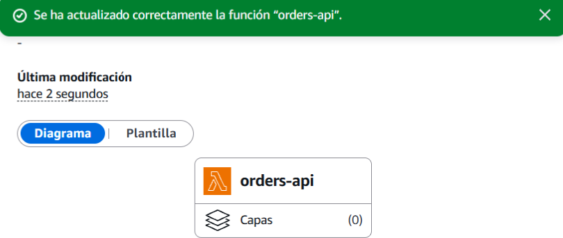

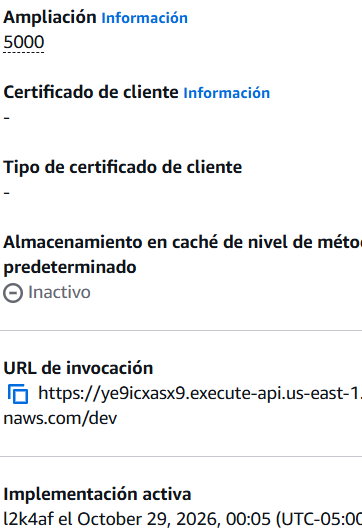

### Respuestas comprobadas en la URL pública

| Petición | Estado | Cuerpo / headers |
|---|---|---|
| `GET /orders/ORD-001` | 200 | `{"id":"ORD-001","customerId":"CUST-42","product":"MacBook Air","quantity":1}` |
| `GET /orders/ORD-999` | 404 | `{"error":"ORDER_NOT_FOUND","message":"Order ORD-999 does not exist"}` |
| `GET /orders?customerId=CUST-42` | 200 | `[{"id":"ORD-001",...},{"id":"ORD-002",...}]` |
| `GET /orders?customerId=CUST-100` | 200 | `[]` |
| `GET /orders` | 400 | `{"error":"INVALID_REQUEST","message":"customerId is required"}` |
| `POST /orders` válido | **201** | `Location: /dev/orders/ORD-004` + la orden creada |
| `POST /orders` con `quantity: 0` | 400 | `{"error":"INVALID_REQUEST","message":"quantity must be greater than 0"}` |
| `POST /orders` con `quantity: "abc"` | 400 | `{"error":"INVALID_REQUEST","message":"Request body is not valid JSON"}` |
| `POST /orders` con JSON truncado | 400 | `{"error":"INVALID_REQUEST","message":"Request body is not valid JSON"}` |
| `POST /orders` sin cuerpo | 400 | `{"error":"INVALID_REQUEST","message":"Request body is required"}` |
| `PATCH /orders/ORD-001` | 405 | `{"error":"METHOD_NOT_ALLOWED","message":"Method PATCH is not allowed on /orders/{id}"}` |

El detalle completo de las respuestas se conserva en [docs/examples/architecture-b.txt](docs/examples/architecture-b.txt).

**Datos visibles entre operaciones.** Todas las rutas pasan por la misma Lambda, por lo que un `POST` puede consultarse enseguida mediante `GET`. La dirección recibida en `Location` (`/dev/orders/ORD-006`) respondió 200, y `GET /orders?customerId=CUST-77` mostró las dos órdenes creadas. La Arquitectura A, al usar una función por operación, no compartía esos datos. Esta visibilidad sigue limitada a un entorno en memoria: instancias simultáneas y nuevos entornos no comparten ni conservan la información.

---

## 6. Ejercicio final — Predicción para `DELETE /orders/{id}`

> Esta predicción se registró **antes** de desarrollar la operación; la sección siguiente contrasta lo esperado con el resultado real.

Se esperaba que `DELETE /orders/ORD-001` devolviera `204 No Content` sin cuerpo, y que `DELETE /orders/ORD-999` respondiera `404 Not Found` con `{"error":"ORDER_NOT_FOUND",...}`.

El cambio previsto corresponde a la **Arquitectura B** (proxy), que es la que se amplía.

**1. ¿Qué clases Java requieren cambios?**
- `OrderRepository`: incorporar `removeOrderById(String orderId)` para informar si la orden estaba almacenada.
- `InMemoryOrderRepository`: implementar la operación eliminando la entrada del mapa.
- `OrderService`: añadir `removeOrder(String orderId)`, validar el identificador y lanzar `OrderNotFoundException` si no existe.
- `OrdersApiHandler`: admitir `DELETE` en `/orders/{id}`.

No se preveían modificaciones en `Order`, `CreateOrderRequest` ni las excepciones de dominio. Tampoco en los handlers de la Arquitectura A, ya que el cambio no la amplía.

**2. ¿Hace falta crear otra función Lambda?**
No. `orders-api` ya procesa todas las rutas; solo se necesita cargar el JAR actualizado. La Arquitectura A requeriría otra función o, como mínimo, otro handler por su patrón de separación.

**3. ¿Hay que modificar API Gateway?**
No. `/orders/{id}` ya usa `ANY` con integración proxy, así que el verbo `DELETE` llega a Lambda. La respuesta actual **405 generada por Java** (`METHOD_NOT_ALLOWED`), en vez del 403 de API Gateway, confirma que la ruta está conectada. Con la Arquitectura A habría que crear el método DELETE, su plantilla, los estados 204/404, la expresión del 404 y volver a publicar la etapa.

**4. ¿Qué capa debe ejecutar el borrado?**
La aplicación: `OrderService.removeOrder` valida que el id se haya enviado y que la orden exista; `OrderRepository` realiza la eliminación. El handler no accede al repositorio directamente.

**5. ¿Qué componente traduce el resultado a 204 o 404?**
El adaptador HTTP (`OrdersApiHandler`). `OrderService` representa el resultado con una finalización normal o `OrderNotFoundException`; el adaptador convierte el éxito en 204 vacío y la excepción en 404. La traducción para 404 ya existe en el `catch` del handler.

**6. ¿Qué cobertura se requiere?**
- `OrderServiceTest`: comprobar que la orden eliminada ya no se obtiene, que una orden inexistente produce `OrderNotFoundException`, que un identificador vacío produce `ValidationException` y que las demás órdenes del cliente permanecen.
- `OrdersApiHandlerTest`: verificar DELETE existente → 204 sin cuerpo; DELETE inexistente → 404 con el error; GET posterior a la eliminación → 404; segundo DELETE de la misma orden → 404.

---

## 7. Ejercicio final — Implementación de `DELETE /orders/{id}` y contraste con la predicción

### Archivos y pruebas modificados

| Archivo | Cambio |
|---|---|
| [OrderRepository.java](src/main/java/edu/eci/orders/application/OrderRepository.java) | `boolean removeOrderById(String orderId)` |
| [InMemoryOrderRepository.java](src/main/java/edu/eci/orders/infrastructure/InMemoryOrderRepository.java) | `ordersById.remove(orderId) != null` |
| [OrderService.java](src/main/java/edu/eci/orders/application/OrderService.java) | `removeOrder(String orderId)`: valida el identificador y lanza `OrderNotFoundException` si no existe |
| [OrdersApiHandler.java](src/main/java/edu/eci/orders/lambda/proxy/OrdersApiHandler.java) | ruta `DELETE` en `/orders/{id}` → `204` sin cuerpo |
| [OrderServiceTest.java](src/test/java/edu/eci/orders/application/OrderServiceTest.java) | 4 pruebas nuevas (5 casos) |
| [OrdersApiHandlerTest.java](src/test/java/edu/eci/orders/lambda/proxy/OrdersApiHandlerTest.java) | 4 pruebas nuevas |

En total hay **49 pruebas**, ejecutables con `mvn test`.

```java
// OrderService: regla de negocio independiente de HTTP
public void removeOrder(String orderId) {
    requireNonBlank(orderId, "id");
    if (!orderRepository.removeOrderById(orderId.trim())) {
        throw new OrderNotFoundException(orderId.trim());
    }
}

// OrdersApiHandler: traducción a HTTP
if ("DELETE".equals(method)) {
    orderService.removeOrder(parameterValue(requestEvent.getPathParameters(), "id"));
    return new APIGatewayProxyResponseEvent().withStatusCode(204);
}
```

### Comparación entre lo previsto y lo implementado

| Pregunta | Predicción | Resultado |
|---|---|---|
| Clases que cambian | Repositorio (interfaz e implementación), servicio y adaptador | ✅ Exactamente esas cuatro. `Order`, `CreateOrderRequest`, las excepciones y los handlers de la Arquitectura A no cambiaron. |
| ¿Nueva Lambda? | No | ✅ Se subió el JAR nuevo a `orders-api`. |
| ¿Cambia API Gateway? | No, `ANY` ya enruta el DELETE | ✅ No se tocó `orders-api-proxy` ni se volvió a implementar la etapa. |
| Lógica de borrado | `OrderService` + repositorio | ✅ |
| Decisión 204/404 | Adaptador HTTP | ✅ El 204 está en la rama `DELETE`. El 404 no necesitó código nuevo: lo produce el `catch (OrderNotFoundException)` que ya existía para el GET. |
| Pruebas | 4 del servicio y 4 del adaptador | ✅ |

La predicción no contempló que el `204` se envía **sin** `Content-Type` al no tener cuerpo. En la Arquitectura A, `DELETE /orders/ORD-001` aún da `403 Missing Authentication Token`, ya que esa operación no se configuró allí. Para incorporarla se necesitarían una Lambda, un método, plantillas, respuestas de método e integración y una nueva publicación.

---

## 8. Punto de control 3 — Funciones de API Gateway en la Arquitectura A

En la Arquitectura A, estas tareas quedan bajo control de API Gateway:

| Responsabilidad | Dónde se configuró |
|---|---|
| Enrutamiento: recurso + método → función Lambda | Recursos y métodos (`/orders` GET/POST, `/orders/{id}` GET → 3 Lambdas) |
| Extraer el parámetro de ruta `{id}` | Plantilla de solicitud de `GET /orders/{id}` |
| Extraer el parámetro de consulta `customerId` | Plantilla de solicitud de `GET /orders` |
| Transformar la petición en el JSON que espera cada handler | Plantillas de mapeo de solicitud (VTL) |
| Elegir el código de éxito (200 o 201) | Respuesta de integración predeterminada de cada método |
| Mapear errores a códigos HTTP (400, 404) | Expresiones regulares sobre `errorMessage`, por método |
| Transformar la respuesta de error (quitar `errorType` y `stackTrace`) | Plantillas de mapeo de respuesta, por código y por método |
| Declarar qué códigos puede responder cada método | Respuestas de método |
| Responder a rutas inexistentes | Respuesta propia de API Gateway: `403 Missing Authentication Token` |

Lambda valida los datos y determina *qué* error se produjo (`INVALID_REQUEST`, `ORDER_NOT_FOUND`), mientras API Gateway asigna el estado HTTP.

**Aspectos favorables**

- Los handlers Java son pequeños y tipados (`GetOrderInput` → `Order`), sin conocimiento de HTTP, encabezados o estados.
- API Gateway muestra de forma explícita el contrato HTTP: rutas, parámetros y estados disponibles.
- Algunos detalles pueden modificarse sin recompilar ni volver a publicar Java, como el texto de una respuesta.
- Los validadores y modelos de API Gateway podrían descartar solicitudes mal formadas antes de llamar a Lambda, evitando invocaciones innecesarias.

**Aspectos desfavorables** (varios se presentaron durante el ejercicio)

- **Las reglas HTTP están divididas**: Java identifica el error y API Gateway determina el estado. Un cambio requiere actualizar ambos y mantenerlos coordinados mediante una cadena como `"error":"ORDER_NOT_FOUND"` en `errorMessage`.
- **El valor predeterminado puede ocultar fallas**: un error sin regla puede convertirse en 200 y exponer `errorType` y `stackTrace`. Sucedió con `ORD-999` antes de configurar la expresión y con `id is required` tras una plantilla incorrecta.
- **Cada método repite configuración**: plantillas, respuestas de método, expresiones y plantillas de respuesta.
- **La configuración manual es propensa a errores**: las plantillas de ambos GET quedaron asociadas a métodos equivocados y se detectó mediante `curl`; ni el compilador ni las pruebas encuentran ese tipo de problema.
- **La validación de mapeos no es local**: requiere la consola o desplegar el API.
- **Los cambios no se publican de inmediato**: antes de implementar la etapa, `GET /orders` devolvía 403.
- **Hay límites en las transformaciones**: no se pudo construir `Location` y tampoco editar el estado de una respuesta de integración ya creada.
- La configuración realizada con clics no está versionada en Git; solo se conservaron las plantillas de [apigateway/architecture-a/](apigateway/architecture-a/) y esta guía.

---

## 9. Evaluación comparativa

**¿Cuál configuró más elementos en API Gateway?**
La **A**, por un margen amplio: necesitó tres métodos, tres plantillas de solicitud, cinco respuestas de método adicionales (201, dos 400, 404 y la sustitución del 200), más tres respuestas de integración con expresiones y sus plantillas. La **B** se limita a dos métodos `ANY` con proxy.

**¿Cuál añadió más código de infraestructura Java?**
La **B**, que implementa `OrdersApiHandler` para enrutar, extraer parámetros, leer el cuerpo, definir estados y encabezados, y serializar respuestas. También requiere `aws-lambda-java-events` y Jackson. En la A, los handlers son breves, junto con `OrderApiException` y `Errors`.

**¿Qué variante resultó más sencilla de probar localmente?**
La **B**. Sus 16 pruebas de `OrdersApiHandlerTest` verifican estado, encabezados y cuerpo sin AWS, incluido el caso 500. En la A, las pruebas solo inspeccionan `errorMessage`; el estado HTTP depende de expresiones y plantillas que deben verificarse en AWS.

**¿En qué lugar se seleccionan los estados HTTP?**
- A: API Gateway aplica la respuesta predeterminada, las expresiones para errores de Lambda y las respuestas de método, separado del código Java.
- B: Java los decide en `OrdersApiHandler` mediante `createJsonResponse(200, ...)`, `createJsonResponse(201, ...)`, `withStatusCode(204)` y los bloques `catch` de 400/404/500.

**¿Cómo escalarían de tres a treinta operaciones?**
- A: la configuración manual aumentaría de forma proporcional (plantillas, expresiones y respuestas), al igual que las funciones Lambda bajo este patrón. Cada operación repetiría pasos propensos a errores y exigiría republicar la etapa.
- B: API Gateway casi no necesitaría cambios (también se podría usar `{proxy+}`); las rutas crecerían en Java, con compilador, pruebas y control de versiones. El riesgo es que `OrdersApiHandler` se vuelva demasiado grande. Conviene extraer una tabla de rutas o handlers por recurso y valorar dividir las funciones por dominio.

**¿En qué diseño queda más aislada la lógica de negocio?**
En **los dos** `OrderService` conserva la misma lógica y no depende de HTTP ni AWS; fue el núcleo estable durante el ejercicio. La diferencia está en el adaptador: la A introduce indirectamente códigos HTTP en mensajes que las expresiones deben reconocer, mientras que la B reúne explícitamente el comportamiento HTTP en una clase.

**¿Cuál sería más clara para quien mantiene el sistema?**
La **B**: la lógica HTTP aparece en un archivo Java y sus pruebas describen el comportamiento. En la A hay que revisar en la consola cada método, sus plantillas VTL y expresiones; sin documentación, no siempre queda claro por qué un error produce 404.

**¿Qué opción elegir para un servicio de mayor tamaño?**
La **B**, con algunas consideraciones. El comportamiento queda versionado y cubierto por pruebas, se publica como una unidad y API Gateway se concentra en exponer el endpoint, TLS, limitación de tráfico, autorización y CORS. Las responsabilidades transversales (autenticación, cuotas y posiblemente validación de esquemas) pueden permanecer en API Gateway; la traducción entre HTTP y la aplicación corresponde al adaptador. La configuración debería gestionarse como código mediante SAM, CDK o Terraform, no solo desde la consola. La A puede ser adecuada para APIs pequeñas y estables o para adaptar un backend que no se puede modificar.

---

## 10. Arquitectura final

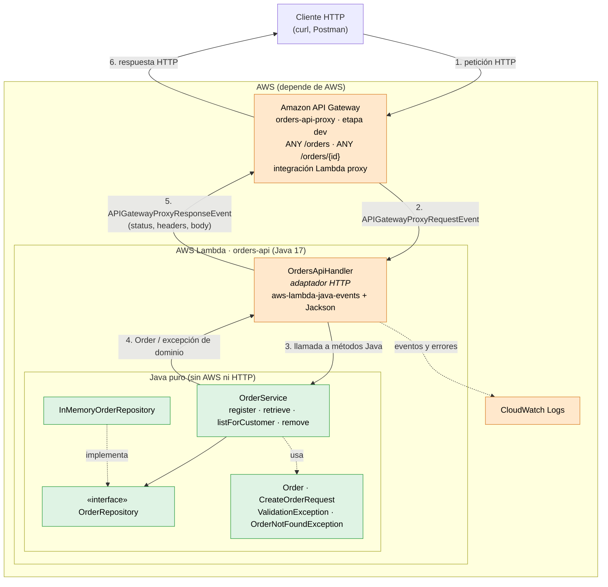

- **Naranja (acoplado a AWS):** API Gateway, CloudWatch y `OrdersApiHandler`, que depende de `aws-lambda-java-core` y `aws-lambda-java-events`.
- **Verde (Java independiente):** `domain`, `application` e `infrastructure`. Se pueden compilar y probar sin AWS, o reutilizar detrás de Spring, una CLI u otra nube.
- Las referencias apuntan hacia el núcleo: el adaptador conoce el servicio; el servicio no depende del adaptador.

**Arquitectura A, para comparación:**

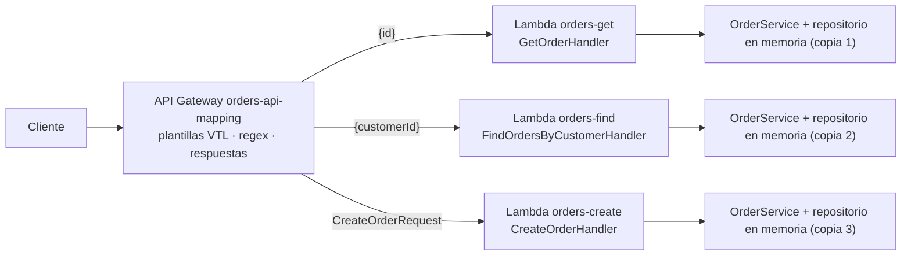

---

## 11. Respuesta ante errores internos

| Situación | Arquitectura A | Arquitectura B |
|---|---|---|
| Excepción imprevista en `OrderService` o el repositorio | `Errors.mapDomainFailure` la transforma en `INTERNAL_ERROR`. Como solo existen expresiones para 400/404, API Gateway termina usando la **respuesta predeterminada (200/201)** y puede incluir `errorType` y `stackTrace`. Para devolver 500 sería necesario agregar el estado y la expresión `INTERNAL_ERROR` a **cada método**. | El `catch (RuntimeException)` de `OrdersApiHandler` genera **`500 {"error":"INTERNAL_ERROR","message":"Unexpected error"}`**. La traza queda en CloudWatch, sin exponerse al cliente; lo verifica `shouldReturn500WithoutExposingUnexpectedFailureDetails`. |
| Problema de Lambda antes o fuera del handler (timeout, memoria agotada, error de arranque) | Si no hay mapeo para el error de Lambda, aplica el mismo resultado descrito arriba. | API Gateway devuelve **`502 {"message":"Internal server error"}`** al no recibir una respuesta proxy válida. Java no puede gestionar ese fallo. |

---

## 12. Uso de asistencia de IA durante el desarrollo

Claude se utilizó como apoyo para diseñar la arquitectura antes de programar, implementar de forma incremental y orientar el uso de la consola de AWS. Cada avance se contrastó con pruebas, invocaciones manuales y solicitudes `curl` a la URL pública. La evidencia permitió corregir algunas suposiciones: no se puede editar el estado de una respuesta de integración, la consola traducida presenta otras etiquetas y algunas plantillas habían quedado asociadas al método incorrecto.

Este fue el planteamiento inicial:

```
Parto de una API de órdenes escrita en Java 17 con POST /orders,
GET /orders/{id} y GET /orders?customerId=.... Necesito publicarla usando
AWS Lambda y API Gateway: primero con integración no proxy y plantillas de
transformación, y después con integración Lambda proxy.

El núcleo de la aplicación debe continuar independiente de HTTP y de las
bibliotecas de AWS.

Antes de escribir código:
1. describe la arquitectura sugerida;
2. especifica qué archivos existentes habría que modificar;
3. enumera las clases nuevas;
4. asigna las responsabilidades relacionadas con HTTP.
Espera a explicar el diseño antes de implementar. El entorno es AWS Academy
Learner Lab y únicamente está disponible el rol LabRole.
```

### Revisión de las decisiones sugeridas por el agente

**Decisión 1: separar las operaciones de la Arquitectura A en funciones Lambda.**
- *Motivo de la propuesta:* coincide con el patrón de integración no proxy: cada método de API Gateway invoca una función cuya entrada tipada coincide con la salida de su plantilla (`GetOrderInput`, `FindOrdersInput`).
- *Valoración:* es una división sencilla, pero multiplica la configuración y separa el estado. Por ejemplo, la orden de `orders-create` no aparece en `orders-get` ni en `orders-find`.
- *Otra posibilidad:* utilizar una sola Lambda en la A y enviar desde las plantillas una propiedad como `"operation": "get"` para seleccionar la acción en Java.
- *Decisión aplicada:* se mantuvo una Lambda por operación en la A para contrastarla con la B; en la solución final se usa una sola (`orders-api`).

**Decisión 2: colocar las validaciones en `OrderService`, no en API Gateway.**
- *Motivo de la propuesta:* mantener una fuente única de reglas, verificable con JUnit, y conservar el mismo formato de error en ambas arquitecturas. Por ese motivo `customerId` no se declaró obligatorio en la solicitud del método.
- *Valoración:* es apropiado para reglas de negocio como `quantity > 0`. La validación estructural también podría ejecutarse en API Gateway con modelos y JSON Schema, para rechazar solicitudes incorrectas antes de incurrir en una invocación.
- *Otra posibilidad:* aplicar validación de esquema en API Gateway, personalizar *Gateway Responses* para conservar `{"error","message"}` y dejar las reglas del negocio en el servicio.
- *Decisión aplicada:* todas las validaciones permanecen en el servicio para priorizar coherencia y facilidad de prueba. La validación temprana queda como una mejora posible.

**Decisión 3: codificar el error como JSON en el mensaje y reconocerlo mediante regex.**
- *Motivo de la propuesta:* con integración no proxy, `errorMessage` es el dato del error de Lambda que API Gateway puede evaluar.
- *Valoración:* es funcional, aunque sensible a cambios: Java queda acoplado a una cadena que debe reconocer la expresión. Si no hay coincidencia, se devuelve 200 con `stackTrace`, como sucedió con `id is required`.
- *Otra posibilidad:* evitar excepciones en el handler y devolver un objeto `{"status": 404, "body": {...}}`; una plantilla podría usar `$context.responseOverride.status` para definir el código. Así se eliminan las regex, aunque Java vuelve a decidir el estado.
- *Decisión aplicada:* se conservaron las expresiones porque forman parte del objetivo del ejercicio, y sus riesgos se detallan en las secciones 8 y 11.

**Decisión 4: escribir el evento proxy completo en CloudWatch en cada llamada.**
- *Motivo de la propuesta:* el ejercicio pide examinar el evento enviado por API Gateway y el registro permite observar un ejemplo real.
- *Valoración:* resulta útil en el laboratorio, pero no es recomendable en producción porque el evento contiene encabezados (incluido `Authorization`), IP de origen y el cuerpo con información del cliente.
- *Otra posibilidad:* habilitarlo solo mediante una variable de entorno (`LOG_EVENTS=true`) o limitar el registro al método, ruta e identificador de solicitud.
- *Decisión aplicada:* el registro completo se dejó habilitado para el entorno de práctica; antes de un despliegue real, sería el primer comportamiento que revisaría.

**Decisión 5: tomar `requestContext.path` para formar `Location`.**
- *Motivo de la propuesta:* la ruta `/orders/ORD-004` no basta para el cliente, porque la URL pública también incluye la etapa (`/dev`).
- *Valoración:* es correcto; se confirmó siguiendo el valor de `Location` y obteniendo 200.
- *Otra posibilidad:* formar una URL absoluta con el encabezado `Host` del evento o configurar un dominio personalizado sin etapa en la ruta.
- *Decisión aplicada:* el encabezado usa `Location: /dev/orders/{id}`.